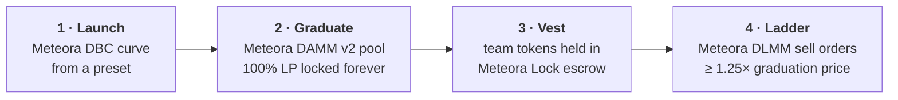

# Ratchet

**A Meteora launchpad where team unlocks only sell into strength.**

**[Live on Solana mainnet →](https://ratchet-olive.vercel.app)** · [Evidence](docs/EVIDENCE.md) · [Architecture](docs/ARCHITECTURE.md) · [Submission](docs/SUBMISSION.md)


Team unlocks are the classic way launches die: a cliff hits and the team market-sells into
holders. Ratchet launches every token on Meteora's bonding curve, graduates it into a pool whose
liquidity can never be pulled, and only lets the team's unlocked tokens reach the market as
sell orders **at 1.25× the graduation price or higher**. If the team sells, it sells into
strength.

## How it works



Four Meteora programs, every transaction built from Meteora's SDKs and signed by the user's
wallet. Half of every DAMM v2 fee compounds back into the pool, so liquidity only deepens.

## Proof on mainnet

| Result | On-chain detail |
|---|---|
| **Launch → graduation in 5 minutes** | CHRL went from launch to a locked DAMM v2 pool through the live app ([timeline + every tx](docs/EVIDENCE.md#mainnet-chrl-launch-to-graduation-in-5-minutes)) |
| **9 wallets** | traded CHRL across DBC and DAMM v2; 7 hit the graduated pool within 15 s |
| **Sniper paid ~37%** | in anti-sniper fees 15 s after launch, and those fees went to the creator |
| **4 preset configs** | including an **equity raise priced in tokenized Tesla stock (TSLAx)** |
| **Full ladder on devnet** | DLMM asks from 1.25× to 6× the graduation price ([txs](docs/EVIDENCE.md#devnet-full-lifecycle-including-the-dlmm-unlock-ladder)) |

## Presets

<picture>
  <source media="(prefers-color-scheme: dark)" srcset="docs/img/preset-curves-dark.svg">
  
</picture>

| Preset | Raises in | For |
|---|---|---|
| **Anti-sniper** | SOL | Memes: launch-block buyers pay up to 50%, decaying to 1% in 2 minutes |
| **Fair raise** | SOL | Communities that want price discovery without a pump: last buyer pays ~5% more |
| **Equity raise** | **TSLAx** | Raising in tokenized stock on the same flat curve, graduating into a TSLAx pool |
| **Micro raise** | SOL | Small raises (0.1 SOL). The thin pool it creates is what our launch check now warns about |

Full parameters and config addresses: [ARCHITECTURE.md](docs/ARCHITECTURE.md#presets). The figure
is generated from live config data by [`scripts/make-figures.mjs`](scripts/make-figures.mjs).

## What's in the box

<table>
<tr>
<td width="50%"><br/><b>Token page</b>: curve, trading on DBC then DAMM v2, team vesting, the public unlock ladder and a launch check</td>
<td width="50%"><br/><b>Launch check for any Meteora DBC token</b>: can LP be pulled, how much of the raise is paid out, mint authority, team vesting, post-graduation exit drain</td>
</tr>
</table>

- **Launch** from four presets ([create page](docs/img/create.png)), with a live curve preview read from each DBC config.
- **Graduate** with one click: anyone can migrate a full curve into DAMM v2.
- **Unlock ladder**: vested team tokens become DLMM limit asks at 1.25× the graduation price or higher.
- **Earnings**: one transaction claims creator, partner and locked-LP fees.
- **For AI agents**: an [MCP server and Agent Skill](packages/ratchet-mcp) to list launches, check any DBC token and build unsigned transactions.
- **Public APIs**: graduation feed, launch check and presets as CORS-open JSON ([endpoints](docs/ARCHITECTURE.md#apis-and-the-mcp-server)).
- **21 unit tests and CI** (typecheck, tests, build) on every push.

## Trust model

Today the ladder is enforced by Ratchet's API and visible on-chain; the creator's wallet owns the
orders. The next version moves the creator role and the ladder into a vault program, so only
the program can cancel an order, and only to move it higher. Both halves are verified against
the DBC and DLMM programs. [Details →](docs/ARCHITECTURE.md#trust-model-and-the-vault)

## Run it locally

```bash
pnpm install
cd scaffolds/fun-launch
cp .env.example .env.local   # RPC_URL, NEXT_PUBLIC_NETWORK=devnet|mainnet, storage
pnpm dev                     # pnpm test runs the unit tests
```

Presets are created with the Invent studio CLI:
`DBC_CONFIG_PATH=../presets/mainnet/anti-sniper.jsonc pnpm dbc-create-config` from [`studio/`](studio).

Built on [Meteora Invent](README.meteora-invent.md).
