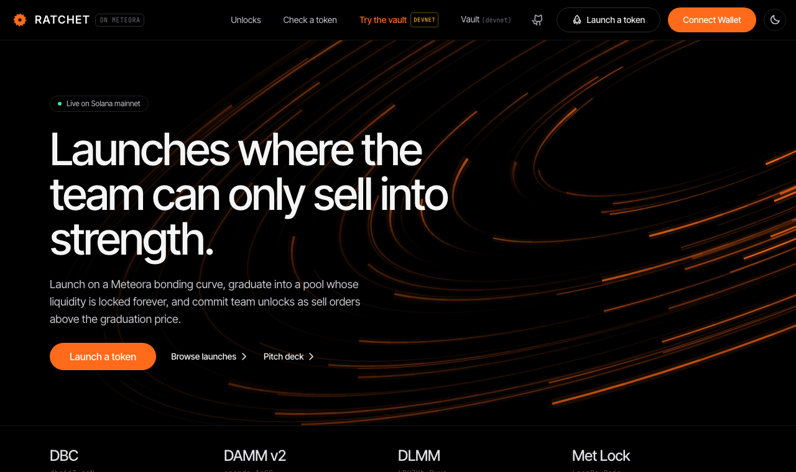
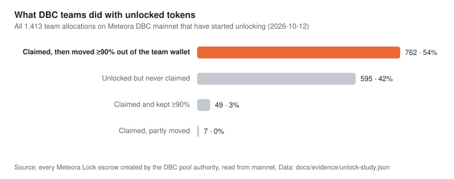
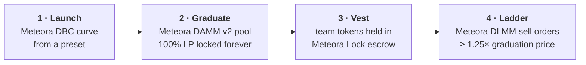
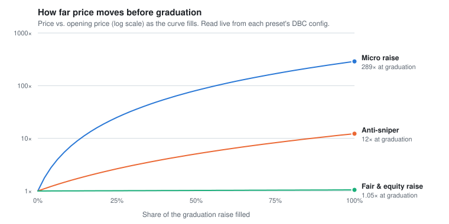
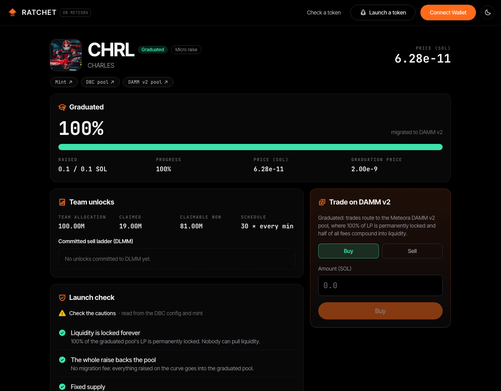
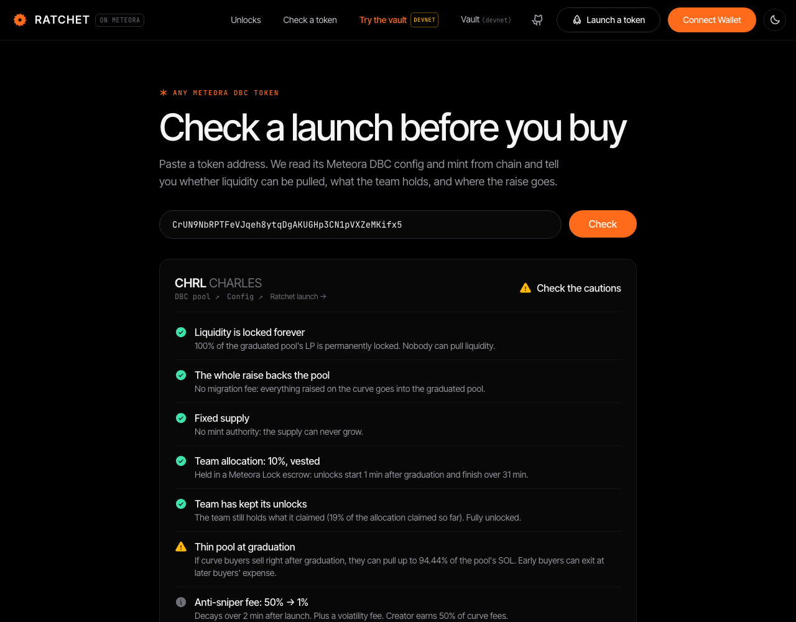

# Ratchet

[](https://github.com/udaysehgal/ratchet/actions/workflows/ci.yml)
[](https://www.useratchet.xyz)
[](docs/EVIDENCE.md)
[](docs/ARCHITECTURE.md#meteora-integration)
[](docs/VAULT.md#threats-and-answers)
[](LICENSE.md)

**A Meteora launchpad where team unlocks only sell into strength.**

**[Live on Solana mainnet →](https://www.useratchet.xyz)** · **[Try the vault yourself →](https://www.useratchet.xyz/try)** · [Unlock study](docs/UNLOCK-STUDY.md) · [Vault](docs/VAULT.md) · [Evidence](docs/EVIDENCE.md) · [Architecture](docs/ARCHITECTURE.md) · [Submission](docs/SUBMISSION.md)



Team unlocks are the classic way launches die: a cliff hits and the team market-sells into
holders. Ratchet launches every token on Meteora's bonding curve, graduates it into a pool whose
liquidity can never be pulled, and only lets the team's unlocked tokens reach the market as
sell orders **at 1.25× the graduation price or higher**. If the team sells, it sells into
strength.

## Verify it in 60 seconds

No wallet needed. Every number below is read live from chain by the deployed app.

```bash
# Our mainnet launches: CHRL graduated into a locked DAMM v2 pool
curl -s https://www.useratchet.xyz/api/feed | jq '.launches[] | {symbol, raised, graduated}'

# The problem: every DBC team allocation on mainnet, and how many teams sold their unlocks
curl -s https://www.useratchet.xyz/api/unlocks | jq .stats

# The fix: the ratchet-vault on devnet, its floor, holdings and the asks it allowed
curl -s https://www.useratchet.xyz/api/vault/9g7Gu6NfiKyUN62UvULD9qx1A4hHh4kA2f4xZTUdMQwp | jq '{floorMultiple, tokensInVault, asks: [.asks[].multiple]}'

# The launch check on any DBC token (here: ours)
curl -s https://www.useratchet.xyz/api/check/CrUN9NbRPTFeVJqeh8ytqDgAKUGHp3CN1pVXZeMKifx5 | jq '[.checks[] | {status, title}]'
```

Every transaction behind these numbers is linked in [EVIDENCE.md](docs/EVIDENCE.md).

## The problem, measured

We read every team allocation on Meteora DBC mainnet. Of **1,413** that have started unlocking,
**762 teams claimed and moved ≥90% of their tokens out** (98.3% of all claimed team tokens have
left team wallets), and in a sample of those, **88% sold through a DEX**: most often straight
into the DAMM v2 pool holders trade in. Only 49 teams kept theirs. [Full study →](docs/UNLOCK-STUDY.md)

<picture>
  <source media="(prefers-color-scheme: dark)" srcset="docs/img/unlock-study-dark.svg">
  
</picture>

## How it works



Four Meteora programs, every transaction built from Meteora's SDKs and signed by the user's
wallet. Half of every DAMM v2 fee compounds back into the pool, so liquidity only deepens.

## Proof on mainnet

| Result | On-chain detail |
|---|---|
| **Launch → graduation in 5 minutes** | CHRL went from launch to a locked DAMM v2 pool through the live app ([timeline + every tx](docs/EVIDENCE.md#mainnet-chrl-launch-to-graduation-in-5-minutes)) |
| **9 wallets** | traded CHRL across DBC and DAMM v2; 7 hit the graduated pool within 15 s |
| **Sniper paid ~37%** | in anti-sniper fees 15 s after launch, and those fees went to the creator |
| **7 preset configs** | including **equity raises priced in tokenized Tesla, NVIDIA, Apple and Alphabet stock** |
| **Full ladder on devnet** | DLMM asks from 1.25× to 6× the graduation price ([txs](docs/EVIDENCE.md#devnet-full-lifecycle-including-the-dlmm-unlock-ladder)) |
| **Vault program on devnet** | enforces the ladder on-chain, 20/20 lifecycle checks ([txs](docs/EVIDENCE.md#devnet-the-vault-enforcing-the-ladder-on-chain)) |

## For judges

| Criterion | Where to look |
|---|---|
| **Depth of Meteora integration** | Four Meteora programs from one app: DBC presets and launches, DAMM v2 trading and locked-LP fees, DLMM limit-order ladder, Meteora Lock vesting, plus Invent studio for configs. Our own program calls DBC, Meteora Lock and DLMM directly. Equity-raise presets in four xStocks (TSLAx, NVDAx, AAPLx, GOOGLx) using Meteora's token badges. [Call table](docs/ARCHITECTURE.md#meteora-integration) |
| **Technical execution** | A native Solana program with conservative Q64.64 price checks, a daily sell cap and a canonical-pair rule; 25/25 end-to-end on public devnet and on Meteora's mainnet binaries locally, deployed by a test-then-deploy workflow. **[Try it yourself](https://www.useratchet.xyz/try)**: launch a vaulted token on devnet and watch the program refuse a below-floor sale. 30 unit tests and CI on every push. [Vault spec](docs/VAULT.md) · [tests](.github/workflows/ci.yml) |
| **Originality** | DLMM limit orders as an *unlock commitment*, enforced by a vault that holds the DBC creator role, plus an **unlock radar** tracking every DBC team allocation on mainnet. Nobody else addresses what happens at unlock. [Vault](#the-vault-enforcing-the-ladder-on-chain) |
| **Impact** | The problem is everywhere: 93% of DBC teams that claim unlocks move them out ([study](docs/UNLOCK-STUDY.md)). Any DBC launchpad can adopt the preset + vault pattern. The launch check grades *any* DBC token; feed, check and MCP server are public. [What's in the box](#whats-in-the-box) |
| **Traction** | Live on mainnet: a graduation through the app, 9 trading wallets, a sniper that paid ~37% in fees, 4 configs. [Evidence](docs/EVIDENCE.md) |

## Presets

<picture>
  <source media="(prefers-color-scheme: dark)" srcset="docs/img/preset-curves-dark.svg">
  
</picture>

| Preset | Raises in | For |
|---|---|---|
| **Anti-sniper** | SOL | Memes: launch-block buyers pay up to 50%, decaying to 1% in 2 minutes |
| **Fair raise** | SOL | Communities that want price discovery without a pump: last buyer pays ~5% more |
| **Equity raise** | **TSLAx · NVDAx · AAPLx · GOOGLx** | Raising in tokenized stock on the same flat curve, graduating into a pool in that stock |
| **Micro raise** | SOL | Small raises (0.1 SOL). The thin pool it creates is what our launch check now warns about |

Full parameters and config addresses: [ARCHITECTURE.md](docs/ARCHITECTURE.md#presets). The figure
is generated from live config data by [`scripts/make-figures.mjs`](scripts/make-figures.mjs).

## What's in the box

<table>
<tr>
<td width="50%"><br/><b>Token page</b>: curve, trading on DBC then DAMM v2, team vesting, the public unlock ladder and a launch check</td>
<td width="50%"><br/><b>Launch check for any Meteora DBC token</b>: can LP be pulled, how much of the raise is paid out, mint authority, team vesting, post-graduation exit drain</td>
</tr>
</table>

- **Unlock radar** (`/unlocks`): every Meteora DBC team allocation, its next unlock, and whether the team sold its past unlocks. The launch check flags teams that did.
- **Launch** from four presets ([create page](docs/img/create.png)), with a live curve preview read from each DBC config.
- **Graduate** with one click: anyone can migrate a full curve into DAMM v2.
- **Unlock ladder**: vested team tokens become DLMM limit asks at 1.25× the graduation price or higher.
- **Earnings**: one transaction claims creator, partner and locked-LP fees.
- **For AI agents**: an [MCP server and Agent Skill](packages/ratchet-mcp) to list launches, check any DBC token and build unsigned transactions.
- **Public APIs**: graduation feed, launch check and presets as CORS-open JSON ([endpoints](docs/ARCHITECTURE.md#apis-and-the-mcp-server)), plus an embeddable launch-check badge for any DBC token: 
- **30 unit tests and CI** (app typecheck, tests and build; vault program tests) on every push.

## The vault: enforcing the ladder on-chain

On mainnet today the ladder is enforced by Ratchet's API and visible on-chain. The
[**ratchet-vault program**](programs/ratchet-vault) makes it binding: it takes the DBC pool's
creator role in the launch transaction, so team vesting and creator fees land in a PDA, and
team tokens can only leave as DLMM asks at ≥ 1.25× the graduation price. The floor only rises.

**Deployed on devnet and passing 25/25 end-to-end checks** ([try it yourself](https://www.useratchet.xyz/try)): asks above the floor accepted,
below-floor asks and floor cuts refused, a buyer lifting the ask with proceeds reaching the team
only through the vault. [Spec](docs/VAULT.md) · [transactions](docs/EVIDENCE.md#devnet-the-vault-enforcing-the-ladder-on-chain)

## Run it locally

```bash
pnpm install
cd scaffolds/fun-launch
cp .env.example .env.local   # RPC_URL, NEXT_PUBLIC_NETWORK=devnet|mainnet, storage
pnpm dev                     # pnpm test runs the unit tests
```

Presets are created with the Invent studio CLI:
`DBC_CONFIG_PATH=../presets/mainnet/anti-sniper.jsonc pnpm dbc-create-config` from [`studio/`](studio).

Built on [Meteora Invent](README.meteora-invent.md).
