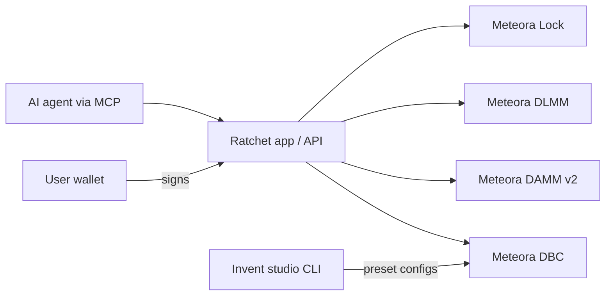
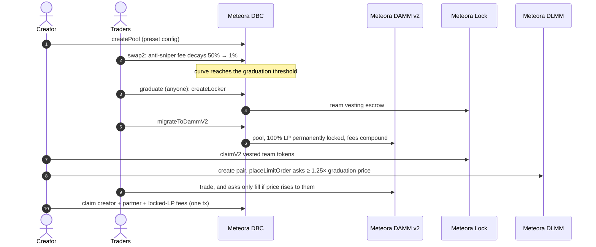

# Architecture

- [Meteora integration](#meteora-integration)
- [A launch, step by step](#a-launch-step-by-step)
- [Presets](#presets)
- [Trust model and the vault](#trust-model-and-the-vault)
- [Launch check](#launch-check)
- [APIs and the MCP server](#apis-and-the-mcp-server)
- [Repository layout](#repository-layout)

## Meteora integration

Every on-chain action in Ratchet goes through a Meteora program. The server layer is one file,
[`scaffolds/fun-launch/src/server/meteora.ts`](../scaffolds/fun-launch/src/server/meteora.ts);
transactions are built there and signed by the user's wallet.

| Program / SDK | What Ratchet uses it for | Calls |
|---|---|---|
| **DBC** (`@meteora-ag/dynamic-bonding-curve-sdk` 1.5.13) | Preset configs, launches, curve trading, graduation, fee claims, vesting locker, previews | `partner.createConfig` (Invent studio, with `tokenBadge` for xStock quotes), `creator.createPool` (with `tokenBadge`), `pool.swap2` (PartialFill buys so the last buyer can't overshoot graduation) + `pool.swapQuote2`, `migration.createLocker`, `migration.migrateToDammV2`, `creator.claimCreatorTradingFee`, `partner.claimPartnerTradingFee`, `partner.claimPartnerPoolCreationFee`, `state.getPoolsByConfig`, `state.getPoolByBaseMint`, `state.getPoolConfig`, `deriveEscrow(deriveBaseKeyForLocker(pool))`, `getDeltaAmountQuoteUnsigned` |
| **DAMM v2** (`@meteora-ag/cp-amm-sdk`) | Post-graduation trading and locked-LP fee claims | `fetchPoolStatesByTokenAMint`, `getQuote2` + `swap2`, `getPositionsByUser`, `getUserPositionByPool`, `getUnClaimLpFee`, `claimPositionFee2` |
| **DLMM** (`@meteora-ag/dlmm`) | The unlock ladder | `createCustomizablePermissionlessLbPair2` (limit-order function type), `placeLimitOrder` (ask side), `getLimitOrderByUserAndLbPair`, `getBinIdFromPrice`, `getPriceOfBinByBinId` |
| **Meteora Lock** (`@meteora-ag/met-lock-sdk`) | Team vesting escrow DBC creates at graduation | `getEscrow`, `claimV2` |
| **Invent studio** ([`studio/`](../studio)) | Creating and rehearsing presets on devnet and mainnet | `dbc-create-config`, `dbc-create-pool`, `dbc-swap`, `dbc-migrate-to-damm-v2`, `dlmm-create-pool`, `dlmm-place-limit-order`, `lock-claim` |
| **fun-launch scaffold** | Frontend base, heavily rewritten | |

## A launch, step by step

## Presets

Created with the Invent studio CLI from [`presets/mainnet/`](../presets/mainnet). Parameters are
also read live from each config by `GET /api/presets`.

| | Anti-sniper | Fair raise | Micro raise | Equity raise |
|---|---|---|---|---|
| Config | [`6tMtkf…YhH9`](https://solscan.io/account/6tMtkfHkvvSVsCSpXbcCqVCAJYEg7SJQkDmvYH2urYh9) | [`Ery2mG…wwBW`](https://solscan.io/account/Ery2mGuMQ27iV3wCqCd7Ne45XkRCV6fSf2s1j87WwwBW) | [`FQt9kW…goGp`](https://solscan.io/account/FQt9kWsBwHwkhq3TEBXCWqnEqD2GxjxjBVNuJ29igoGp) | [`BBzvZ8…wCC1`](https://solscan.io/account/BBzvZ84fDNHeE7y4ZiYhBgWRN3dZr6gjdFm9TMJ8wCC1) |
| Raises in | SOL | SOL | SOL | **TSLAx, NVDAx, AAPLx or GOOGLx** (xStocks; one config each) |
| Curve | `buildCurve`, 20% of supply to the graduated pool | custom sqrt prices: last buyer pays ~5% more than the first | `buildCurve`, 5% to the graduated pool | same as fair raise |
| Graduates at | 10 SOL | ~10 SOL | 0.1 SOL | ~$1,900 of stock (5 TSLAx, 8.4 NVDAx, 5.7 AAPLx, 5.4 GOOGLx) |
| Base fee | exponential scheduler, 50% → 1% over 2 min, + volatility fee | 1% flat | as anti-sniper | 1% flat |
| Launch fee | 0.02 SOL (90% to partner) | 0.02 SOL | none | none |
| Curve fee split | 50% creator / 50% partner | same | same | same |
| Team allocation | 10% via DBC locked vesting: 1% 1 h after graduation, 9% daily for 30 days | same | 1% after 60 s, the rest every minute for 30 min | as anti-sniper |
| Graduated pool | DAMM v2: 1% fee, dynamic fee, 50% of fees compound into liquidity, 100% of LP permanently locked | same | same | same, in TSLAx |

Configs: TSLAx [`BBzvZ8…wCC1`](https://solscan.io/account/BBzvZ84fDNHeE7y4ZiYhBgWRN3dZr6gjdFm9TMJ8wCC1), NVDAx [`6DaBRb…tddc`](https://solscan.io/account/6DaBRbCGaGW4vNDiHgrk7WC8XudL8tt484Anu3Xftddc), AAPLx [`8jHJkk…U8jN`](https://solscan.io/account/8jHJkk4EEcUP5LJq2H1JB9YmauwvNhuhrFKNtyJxU8jN), GOOGLx [`jqine2…Gkfp`](https://solscan.io/account/jqine24k4Wdm2YA7QkBYKL4ZjRTckmAEnsfCPBVGkfp). Each is the same curve scaled so the raise is the same in dollars.

**xStocks** (TSLAx shown; the others are the same) are Token-2022 mints. TSLAx with a permanent delegate, pausable config, scaled UI amount and a
transfer-hook extension with no program set. Meteora has issued it token badges on DBC and DAMM v2.
SDK 1.5.11 couldn't pass the DBC badge (the program rejects config creation with
`InvalidTokenBadge`); with 1.5.13 Ratchet passes it on config and pool creation. Swaps and
migration need no badge. Every amount in the app, feed, check and MCP server is shown in each
launch's own quote token ([`lib/quotes.ts`](../scaffolds/fun-launch/src/lib/quotes.ts)).

## Trust model and the vault

Today the ladder is a **public commitment enforced by Ratchet's API**: the server refuses to
build orders below 1.25× the graduation price ([`lib/ladder.ts`](../scaffolds/fun-launch/src/lib/ladder.ts),
shared with the UI and unit-tested), and every order is visible on-chain and on the token page.
The creator's wallet owns the orders, so it could cancel them directly.

The [ratchet-vault program](../programs/ratchet-vault) makes it binding, and runs on devnet
([spec](VAULT.md), [transactions](EVIDENCE.md#devnet-the-vault-enforcing-the-ladder-on-chain)). It rests on:

- DBC's `transfer_pool_creator` works at any point before the curve completes. Moving the
  creator role to a vault PDA sends the vesting escrow, creator fees and creator LP to the vault.
- DLMM's `place_limit_order` does not require the order `owner` to sign, but
  `cancel_limit_order` does. A vault PDA can own the ladder, and only the vault program can
  cancel or re-place it, and only upward.

Mainnet showed why this matters: on CHRL a sniper paid ~37% in fees and still drained the
graduated pool seconds later ([EVIDENCE.md](EVIDENCE.md#what-mainnet-taught-us)). Fees tax
unwanted supply; only a program can hold it back.

## Launch check

[`lib/launchCheck.ts`](../scaffolds/fun-launch/src/lib/launchCheck.ts) (pure, unit-tested) and
[`server/check.ts`](../scaffolds/fun-launch/src/server/check.ts) (chain reads) grade **any**
Meteora DBC token, not only Ratchet's, from its config and mint:

| Check | Fails when | Warns when |
|---|---|---|
| Liquidity | any graduated LP is unlocked | LP vests to the partner or creator |
| Migration fee | ≥ 25% of the raise is paid out at graduation | any is |
| Supply | mint authority is set, or the config hands it out | supply grows at migration |
| Freeze | freeze authority is set | |
| Team allocation | | > 30% of supply |
| Exit drain | | curve buyers can pull > 90% of the graduated pool's quote by selling at once |
| Team unlocks | the team moved ≥ 90% of the tokens it claimed out of its wallet | it moved some (passes if a Ratchet vault holds the allocation) |

On real mainnet configs it already flags launches that pay out 99% of the raise at graduation.

## APIs and the MCP server

| Endpoint | What it returns |
|---|---|
| `GET /api/feed?minProgress=0.8&status=live` | Every Ratchet launch: mint, pool, config, quote token, amount raised, threshold, progress (CORS-open) |
| `GET /api/launch/<mint>` | One launch: prices, DAMM v2 pool, vesting, DLMM ladder |
| `GET /api/check/<mint>` | Launch check for any DBC token (CORS-open) |
| `GET /api/badge/<mint>` | Embeddable SVG badge with the launch-check result |
| `GET /api/unlocks` | Unlock radar: every DBC team allocation, upcoming unlocks, which teams sold or kept their unlocks |
| `GET /api/vault/<address>` | Live state of a ratchet-vault on devnet: floor, holdings, open asks, history |
| `GET /api/presets` | Live parameters and curve points of each preset |
| `POST /api/tx` | Unsigned transaction: `swap`, `graduate`, `claim-vesting`, `create-dlmm-pair`, `ladder`, `claim-fees` |

[`packages/ratchet-mcp`](../packages/ratchet-mcp) wraps these for AI agents (`list_launches`,
`get_launch`, `check_token`, `list_presets`, `build_transaction`). It holds no keys; the user's
wallet signs. [`SKILL.md`](../packages/ratchet-mcp/SKILL.md) tells the model to run a check
before any buy.

## Repository layout

| Path | What |
|---|---|
| [`scaffolds/fun-launch`](../scaffolds/fun-launch) | The Next.js app: pages, API routes, Meteora server layer |
| [`presets/`](../presets) | Preset configs for the Invent studio CLI (devnet and mainnet) |
| [`studio/`](../studio) | Meteora Invent studio, with config-path overrides and xStock token-badge support |
| [`programs/ratchet-vault`](../programs/ratchet-vault) | The vault program (native Solana), Meteora IDLs, local-validator script |
| [`packages/ratchet-mcp`](../packages/ratchet-mcp) | MCP server and Agent Skill |
| [`scripts/make-figures.mjs`](../scripts/make-figures.mjs) | Regenerates the README figure from live preset data |
| [`.github/workflows/ci.yml`](../.github/workflows/ci.yml) | Typecheck, unit tests, production build, MCP typecheck |
