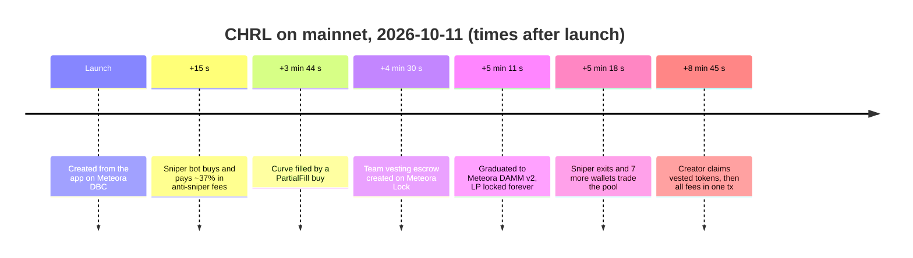

# Evidence

Everything Ratchet claims, with a transaction link for each. Mainnet first, then the devnet run
for the one step we didn't pay for on mainnet (the DLMM unlock ladder).

- [Mainnet: configs](#mainnet-preset-configs)
- [Mainnet: CHRL, launch to graduation in 5 minutes](#mainnet-chrl-launch-to-graduation-in-5-minutes)
- [What mainnet taught us](#what-mainnet-taught-us)
- [Devnet: the vault enforcing the ladder on-chain](#devnet-the-vault-enforcing-the-ladder-on-chain)
- [Devnet: the full lifecycle including the DLMM ladder](#devnet-full-lifecycle-including-the-dlmm-unlock-ladder)
- [Verify it yourself](#verify-it-yourself)

## Mainnet: preset configs

Created with the Invent studio CLI from [`presets/mainnet/`](../presets/mainnet). Partner and fee
claimer wallet `5mjWGA…cSsyBi`; deployer `4re4BQ…EMLV`.

| Preset | Quote | Config | Tx |
|---|---|---|---|
| Anti-sniper | SOL | [`6tMtkf…YhH9`](https://solscan.io/account/6tMtkfHkvvSVsCSpXbcCqVCAJYEg7SJQkDmvYH2urYh9) | [tx](https://solscan.io/tx/46mMhaiNwevdsrX4TamLJ5oSiRYYzZ5kvygDiqZSH85DTBschGYjizxkxGxUywKZTNWNiBdTxouZTjgjkh5VcZs2) |
| Fair raise | SOL | [`Ery2mG…wwBW`](https://solscan.io/account/Ery2mGuMQ27iV3wCqCd7Ne45XkRCV6fSf2s1j87WwwBW) | [tx](https://solscan.io/tx/4FeJYGd9KyjWGDy1hjPs6AQvzfcXnGQg8LPtRyQo4ohDduN6VpXgGUrdzj6KYpzSGfPTp64JjUd6mi6j39rs9HN8) |
| Micro raise | SOL | [`FQt9kW…goGp`](https://solscan.io/account/FQt9kWsBwHwkhq3TEBXCWqnEqD2GxjxjBVNuJ29igoGp) | [tx](https://solscan.io/tx/5GRNsZkJkdQjtDCWU8zqpH4SmmrHMfiPSFAprpPHuxwtxAGaxzR43S4iyM7xfaTbRFz1NhiGYPqJUZ8Uz3ADf8HZ) |
| Equity raise | **TSLAx** (Tesla xStock, Token-2022, with Meteora's DBC token badge) | [`BBzvZ8…wCC1`](https://solscan.io/account/BBzvZ84fDNHeE7y4ZiYhBgWRN3dZr6gjdFm9TMJ8wCC1) | [tx](https://solscan.io/tx/H7G695qJrDwSjqcuJLTu5PJS4Cu986gFL86qzqWt8CC5aMZZ4vxR9Xs84gCcs7F6eNSVMwtckQQ8qXCVviUr14c) |
| Equity raise | **NVDAx** | [`6DaBRb…tddc`](https://solscan.io/account/6DaBRbCGaGW4vNDiHgrk7WC8XudL8tt484Anu3Xftddc) | [tx](https://solscan.io/tx/4JSiqgWRs2A6aU3nraQy6B33vKsi3z8n7M4poPCuJNH5dsjy6qH6ggeWB445999KFWKUWyBghAdvG481yr6x9xdK) |
| Equity raise | **AAPLx** | [`8jHJkk…U8jN`](https://solscan.io/account/8jHJkk4EEcUP5LJq2H1JB9YmauwvNhuhrFKNtyJxU8jN) | [tx](https://solscan.io/tx/65jid5RfTC5mjHiF6o2hEejN6XYuGJ4eKdF6Vg8CCZApaJpV9wFC7zBDNrjmD47dabo4GdUdGGsNwpU9YsNCZtA6) |
| Equity raise | **GOOGLx** | [`jqine2…Gkfp`](https://solscan.io/account/jqine24k4Wdm2YA7QkBYKL4ZjRTckmAEnsfCPBVGkfp) | [tx](https://solscan.io/tx/2qNSL3QMQZaZKQPDHH9hgVP73tP1Wxa9nXNbQP7egoVs8pY93fP9EqHhkNPk7V1dkQvapMQF96PWeB5YiKo3mPYg) |

## Mainnet: CHRL, launch to graduation in 5 minutes

Micro-raise preset, launched and graduated through the live app on 2026-10-11 (UTC).
Mint [`CrUN9N…ifx5`](https://solscan.io/account/CrUN9NbRPTFeVJqeh8ytqDgAKUGHp3CN1pVXZeMKifx5) ·
DBC pool [`2S2hTX…wzCg`](https://solscan.io/account/2S2hTXpXMi1MToqjCGgWehGq5sNuscsh3EtoDkARwzCg) ·
DAMM v2 pool [`BTjz62…WEbf`](https://solscan.io/account/BTjz62LaGnREgPDCugdK1JpPYsAvPLTQM6JnrgioWEbf) ·
[token page](https://ratchet-olive.vercel.app/token/CrUN9NbRPTFeVJqeh8ytqDgAKUGHp3CN1pVXZeMKifx5)



| Time | Step | Meteora program | Tx |
|---|---|---|---|
| 19:23:00 | Launch from the app | DBC `InitializeVirtualPoolWithSplToken` | [tx](https://solscan.io/tx/5QtsRSgsNbieQQg2H6sYaZmJxCP3Xk2o9Mm3CXJety78Yz62uqyiyNbD79s6hMViKftqH2b4WKimKHvA6FoUwrB5) |
| 19:23:15 | Sniper bot buys 15 s after launch, pays ~37% in fees | DBC `Swap2` | [tx](https://solscan.io/tx/47YZnUa2ERKiU9NRx2dNVbqGdhQmCAUxLHWrKKkZGv4bkFgRyNgyUSPuksV9zvpqUEBSxDc7xW7uoxeKsAef9aZf) |
| 19:26:44 | Creator buy fills the curve (PartialFill, no overshoot) | DBC `Swap2` | [tx](https://solscan.io/tx/4uCDvw4hoALUG7TaqJs132fYe2K89BGgYBk2yMD2fqnkU6nTVRfMBAeiGWehWHNycSvLYcN8bzQcXPe2yiHxF25b) |
| 19:27:30 | Graduate, step 1: team vesting escrow | DBC `CreateLocker` → Met Lock `CreateVestingEscrowV2` | [tx](https://solscan.io/tx/29a6j3UXSAQzgzd8m7HAG3Ngt6jBjsMYWDdeD1BWHnrfnp7BgApgfs3kbApw8LknJ4MNNpeY7duzXsia24QZSdih) |
| 19:28:11 | Graduate, step 2: migrate, LP permanently locked | DBC `MigrationDammV2` → DAMM v2 | [tx](https://solscan.io/tx/u4xUbeU8oRsEHutFfQ5V51wSQDfBEPxdaPpuCgJU5bGCmxKQmYEnNVoxwLKJzZFsVwpkca6JUgv5fWqCu7ExpbF) |
| 19:28:18 | Sniper sells 7 s after graduation; 7 more wallets trade within 15 s | DAMM v2 `Swap` | [tx](https://solscan.io/tx/kvekUvcL8WnZkfdcu9PyN4VrkTxPeYoQyFJ7oKzq7tkdZGewiG7UNnNCSDva2ZpFVKDdfG5eCeMXCE24tjRgutS) |
| 19:31:20 | Creator claims vested team tokens (19M) | Met Lock `ClaimV2` | [tx](https://solscan.io/tx/3wzFtSMR8qBxUgk3fi51fjT71HJrYH9FWXrTPV1mZAUDyXCVXi9CNMRCuK8Aj4V4erDJEvLefPwf7WTV6NXxfjUg) |
| 19:31:45 | One-tx claim: DBC creator + partner fees and locked-LP DAMM v2 fees | DBC + DAMM v2 | [tx](https://solscan.io/tx/4Z83PVzarc5ocT5jYgmAdZ6Xi1do7LKQd92G5A4dYfFPULbZK4ZRsvousp9BmfFb8Z1v1VztXcQHVzQrYK6ksWFp) |

**Traction at submission:** 4 configs, 2 launches (VRTL, CHRL), 1 graduation, 9 distinct wallets
trading CHRL across DBC and DAMM v2.

## What mainnet taught us

The anti-sniper fee worked at entry: the bot paid ~37% to buy 15 seconds after launch, and that
fee went to the creator and partner. But it still profited by selling into the fresh DAMM v2
pool 7 seconds after graduation, taking ~85% of the pool's SOL.

The micro-raise preset seeds the graduated pool with 5% of supply against 85% sold on the curve,
so curve buyers can drain up to 94% of the pool's SOL by exiting at once (constant product:
S / (B + S)). The [launch check](../README.md#whats-in-the-box) now flags this for any DBC token,
and the figure in the README shows why: micro raise moves price 289× before graduation, fair raise 5%.

Fees tax unwanted supply; they don't stop it. Supply that shouldn't hit a thin pool needs to be
held by a program, not by goodwill: that's Ratchet's [vault program](#devnet-the-vault-enforcing-the-ladder-on-chain),
now running on devnet.

## Devnet: the vault enforcing the ladder on-chain

The [ratchet-vault program](../programs/ratchet-vault) ([`BrwQHe…NzWB`](https://solscan.io/account/BrwQHeRJWXDbXgUVi1TKdoDbnfB5kcRTcieYmSH2NzWB?cluster=devnet), [deploy](https://solscan.io/tx/4RL3kbKwtf1irGG2SnCkpjeJm5jDhdTeQiyfu34Enfh3BA2w7Ugd9ejNmywykWdcHg1wjFGJzymvHNH1DvBiK6o6?cluster=devnet)) ran the full lifecycle on public devnet against Meteora's deployed programs, **20/20 checks**
([`scripts/vault-lifecycle.ts`](../scaffolds/fun-launch/scripts/vault-lifecycle.ts), [raw results](evidence/vault-devnet-run.json)).
Pool [`8MrMPv…9C8A`](https://solscan.io/account/8MrMPvfH9wPGaPZomLEGFwSMyA8Xew5D2aJfHH8u9C8A?cluster=devnet) · vault [`2LmfUM…E6wF`](https://solscan.io/account/2LmfUMgwN3Kt1dmu7MR4KrkJTQBTeMFVhdT4M9jJE6wF?cluster=devnet) · DLMM pair [`8Rkpbt…SUqb`](https://solscan.io/account/8RkpbtVZGWQKAGoYRHBTDWPhdMsYnsvmAJ975LDhSUqb?cluster=devnet)

| Step | What the chain shows | Tx |
|---|---|---|
| Launch + `adopt_launch` in one tx | DBC `InitializeVirtualPoolWithSplToken` then `TransferPoolCreator` to the vault PDA | [tx](https://solscan.io/tx/5LptAc58dS5zLsH6j6nRssr8Ab65GGiEQVt2QD7YKT5vA2XnvD8yL6cmLc5zxM3sAWUrNb3L2gsHm4AuMoe3K974?cluster=devnet) |
| Curve filled | DBC `Swap2` | [tx](https://solscan.io/tx/4PTjxZRHF2y3C1kgYY6rr2j5h4vCALHx6WM1aW2QQNRWezJ5i2Q8wD3zx6gpELJKPo5M4Q49uj4Gj55YocseL4s8?cluster=devnet) |
| Team vesting escrow | recipient is the vault, not the team | [tx](https://solscan.io/tx/2HSHDS7izjfz7JXgA4L42y4D6vk4rYPQB2QFDeoeNW5nUqayjguuF3s7Y5fLKCyBdnkFsbTSjkXVC8uNKa1AXhuU?cluster=devnet) |
| Graduated to DAMM v2 | DBC `MigrationDammV2` | [tx](https://solscan.io/tx/3TG5RKCDZEJz5hjfDMnd4kuFrnLYTP6R4GyjuyR5vNBcsTeqbx4Yr8MsFtAsjnuTZgzRuTWgzniWc4BDc3QwJSTw?cluster=devnet) |
| `claim_vested` | Meteora Lock `ClaimV2` signed by the vault PDA; 10M tokens into the vault, 0 to the team | [tx](https://solscan.io/tx/ChxGpkaZ4ZJN9MfwFUiEB6z4mqt7WNJZvb28f1pL5A6CUh1akqiMksxs6Vd93UPRbwPv1vtRrrJFPhjRwWSBa8N?cluster=devnet) |
| DLMM pair | created by a holder (DLMM requires the creator to hold the token) | [tx](https://solscan.io/tx/3dyErdY9Ugse4JXGerq3zGWejcoK8LwB2ToPZXjKa7jnM8DTsq3Qn3G3m2dNtWW4tTaJm5LRX56e5ARVrZsW8mPy?cluster=devnet) |
| `place_ask` at 1.25× and 2× | DLMM `PlaceLimitOrder`, owner = vault | [tx](https://solscan.io/tx/2guBbnRYjYGrZhERoB858Nqu6G8MfnPzn4ecWMrZLQt1FRK9a82nBhch3pzfmDdiAhwPehJxWxWDvh73BBhyuwBD?cluster=devnet) |
| Refused: ask at 1.2×, one bin under 1.25×, from a non-beneficiary, lowering the floor, ask at 1.3× after raising to 1.5× | `BelowFloor` / `NotBeneficiary` / `FloorCannotDecrease` (rejected in simulation, so no tx) | – |
| `raise_floor` to 1.5× | | [tx](https://solscan.io/tx/ueG1EqpnHwNqwTKS7SUUCNTmq7wWyotJuMMmmMqZ4gftRBZF1NNCNzeiKff5jkQwQ3mRNSLkEdw2G8AoHW7x3Cr?cluster=devnet) |
| A buyer lifts the 1.25× ask | DLMM `Swap2`: the team sold into strength | [tx](https://solscan.io/tx/35iwpdhis9G9rLYzVXxYMJ3gL2qPAWQGnfXWRqDr7EetHAsco49PRiMiusqcG1et7fKdZtQRT3ByxzzBeNYdgEyH?cluster=devnet) |
| `cancel_ask` | unsold tokens back to the vault, sale proceeds to the team | [tx](https://solscan.io/tx/29deY5PafssogLh7fWHToTD9jNJwjQHiNoJMXc5gbHwLiVLY5TratsDGZQrjEpVu6VrgNS7A9LL4NnW2pc1JK7qt?cluster=devnet) |
| `collect_fees` | DBC creator fees claimed by the vault, SOL forwarded to the team | [tx](https://solscan.io/tx/3wGBvm1dbQiPxLjbWZpif3LccwCnPN5VuxGCF8x1VthJQbTs9mjXn13VypkUnpqZ5QhnW3fv7eoYagzX7ay1n3Ld?cluster=devnet) |

The same script also passes 20/20 on a local validator running Meteora's **mainnet** program
binaries ([`local-validator.sh`](../programs/ratchet-vault/scripts/local-validator.sh)).

## Devnet: full lifecycle, including the DLMM unlock ladder

The ladder needs about 0.1 SOL of DLMM bin-array rent, which we didn't spend on mainnet. It ran
end to end on devnet with token RTST1 on 2026-10-10.

| Step | Tx |
|---|---|
| Configs (anti-sniper, fair raise) | [1](https://solscan.io/tx/3SftJHsb4L2efGLTkHeGwgyLCbCX3b9N3dyFb8m4ADVqX5W9ZJunfHxmFjJbzPCtrFox2PWTGrfXi7BQG6kidFFS?cluster=devnet) · [2](https://solscan.io/tx/4BF8rop784xLy6zKSU5j1rweXgrad4ycpnvt6L649gcFMC6aQpnAqKysBq9vhvWvq3J7WT68iwpvpc4YmK7yjNk7?cluster=devnet) |
| Launch | [tx](https://solscan.io/tx/2iMbeeXsWE3NnxWjXXsvGiqcyvnV2gcXgfVwxtz1vMqc22NDntpp6TSiVrktPTFvESkfpSxhoFiF1TXPuiML9oFn?cluster=devnet) |
| Buys to graduation (first one 20 s after launch paid ~26%) | [1](https://solscan.io/tx/3X19tMPoGEu1SDiZJbyhSQdW8sHu6hBPhjaUie4SJXNKDuebiQuWFykFoKFni1JDSUWxoHJp7FVZg6LPnZGNVi3y?cluster=devnet) · [2](https://solscan.io/tx/3nZ2SVbn67X7ujwxU8MDXJpMY293SbQ4Wn8tmWvx7qpxWnFimCtXh9KvXS4wpqysCpBxiugJmGkA3rgzBmFC4vS6?cluster=devnet) · [3](https://solscan.io/tx/25pcGNzkqPQ83zRWT5qPLGCPbKQUUXuoKL3Ve7rTgUfgncPe19wjGvUu8Ys1he9v5sf9Qu4kLFTZpxJTu3KhpXKX?cluster=devnet) |
| Vesting escrow | [tx](https://solscan.io/tx/4S817copM6rsHt8dbvfP6CKNnzxrjtzTxuK9iN5HNPY2t7La2ZEp1LfP2tHi1A2G1NMueLXb32AKWN41t8F7syum?cluster=devnet) |
| Migrate to DAMM v2 | [tx](https://solscan.io/tx/4SaHh2WXm4LThXrm6y39YW5TwrUetjct6wc34gZidDuefPbkUqfq84dhLsCXHD3NwPVk18uFoyPnQciiDfoq74VP?cluster=devnet) |
| DLMM pair (limit-order type) | [tx](https://solscan.io/tx/3JFbqkDyy6DSdZ2CTSYPAQveDGPJevddh2BCfFVkfxKYAhGPJhjQKqebqxn31h2ouMmNECyxdtWDDaBsRV4boPSJ?cluster=devnet) |
| Vesting claims | [1](https://solscan.io/tx/BkJ7NpKCuR5b5YTxF48edcFXZsk5mBrxc7ZEw4dVa3wzVXLkiZWCgtBbqRySSHK9gN7V6aNTrnZuABApmsdZuMh?cluster=devnet) · [2](https://solscan.io/tx/4dHHy4UWZsQ458PHDHZKz8mKJKPZKLbj7mJCLLDCNK5iLjCPwByn94Y228wSSRPDkrxQ6BhYi38nHAvA5wiFLbhq?cluster=devnet) · [3](https://solscan.io/tx/3Dgwm8qa7TL6M3SrFSLdEfdMwhLZ3WqVYSuBvBRMYr3aXsuJ9bU4FSL8Kfp9AHQ7PXpDbG792KPwCWdPaEMNZtQV?cluster=devnet) |
| **Unlock ladder**: DLMM asks at 1.25× → 6× the graduation price | [1](https://solscan.io/tx/4oZC6tSNPNGoPATUaVqzK3bxxaaQz1QaCZep2pZZY7sUyPwVHsEdt7zzzwis5dNobhdwRUYSYLC1Fq71BKZTbAV3?cluster=devnet) · [2](https://solscan.io/tx/2qAkRGz8sRYFKTrTJeaMov54g4GMsfYYYKg77Db3L2FwiAExqN5vMBXm55gN7NfDJeXD27Vgqx61RZeryAXzzp5B?cluster=devnet) |
| One-tx fee claim (DBC + launch fee + locked-LP fees) | [tx](https://solscan.io/tx/2nXYN2tcqnkihyjG9wERD8Ny9iYi2n7KzfAjt6iCfJ2BDjc7gDQuXAxMR5UdFzNpY2Qjt1cxydyZ7Z5WerAx77oA?cluster=devnet) |

## Verify it yourself

No wallet needed; everything below reads mainnet through the live app.

```bash
# Every Ratchet launch, read from chain
curl -s https://ratchet-olive.vercel.app/api/feed | jq '.launches[] | {symbol, quoteSymbol, raised, graduated}'

# CHRL: graduated, its DAMM v2 pool, vesting claimed
curl -s https://ratchet-olive.vercel.app/api/launch/CrUN9NbRPTFeVJqeh8ytqDgAKUGHp3CN1pVXZeMKifx5 \
  | jq '.launch | {migrated, dammV2Pool, vesting}'

# Launch check for any Meteora DBC token
curl -s https://ratchet-olive.vercel.app/api/check/CrUN9NbRPTFeVJqeh8ytqDgAKUGHp3CN1pVXZeMKifx5 | jq '.checks[] | {status, title}'

# Live parameters of each preset, straight from its DBC config
curl -s https://ratchet-olive.vercel.app/api/presets | jq '.presets[] | {id, quoteSymbol, thresholdSol}'
```
